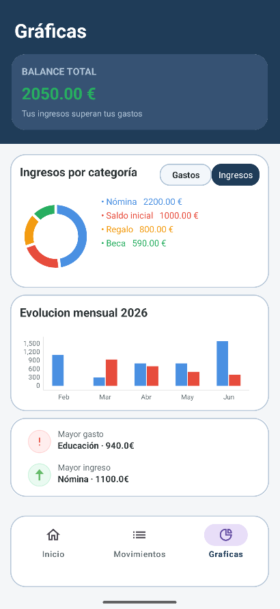
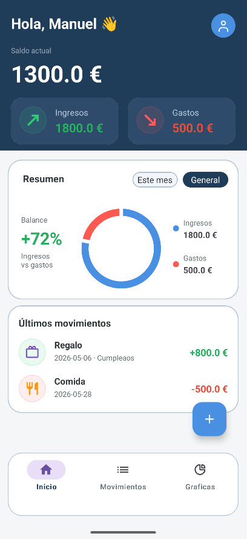
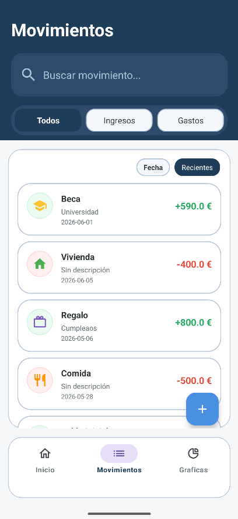

# Balancea

Aplicación móvil Android de **gestión de finanzas personales**, desarrollada como Proyecto Final del Grado Superior en Desarrollo de Aplicaciones Multiplataforma (2026).



## ¿Qué hace?

- **Registro y acceso de usuarios.** Al registrarte por primera vez, indicas tu **saldo actual**.
- **Movimientos.** Puedes añadir gastos e ingresos con su categoría, descripción y fecha, y tu saldo se actualiza automáticamente.
- **Gráficas** para ver tus finanzas de forma visual:
  - Ingresos vs gastos, mensual y anual.
  - Evolución mensual del año.
  - Desglose de ingresos y gastos por categoría.
  - Mayor gasto y mayor ingreso.
- **Perfil de usuario** con cambio de contraseña y cierre de sesión.
- Los datos se guardan **en local** en el dispositivo (SQLite), sin necesidad de conexión.

## Probarla rápidamente

La base de datos se crea con un usuario y movimientos de ejemplo, para poder ver las gráficas sin introducir datos:

- Correo: `admin@gmail.com`
- Contraseña: `admin`

## Tecnologías

- **Java** y **Android Studio** (minSdk 24, targetSdk 36)
- **SQLite** (`SQLiteOpenHelper`) para la persistencia local
- **MPAndroidChart** para las gráficas
- Material Components y ConstraintLayout para la interfaz
- Código documentado con JavaDoc

## Capturas de pantalla

| Inicio | Movimientos | Gráficas |
|---|---|---|
|  |  |  |

## Cómo ejecutarlo

1. Clona el repositorio:
   ```bash
   git clone https://github.com/Manuel7624/TFG_ManuelSastre.git
   ```
2. Ábrelo con **Android Studio** y espera a que termine la sincronización de Gradle.
3. Ejecuta la app en un emulador o en un móvil con Android 7.0 (API 24) o superior.

## Estructura del proyecto

```
app/src/main/java/com/example/balancea/
├── Ventanas/       Pantallas (login, registro, principal, movimientos, gráficas, perfil)
├── Adaptadores/    Adaptador de la lista de movimientos
├── Modelos/        Clases de datos (Usuario, Movimiento)
├── DbHelper.java   Creación y versionado de la base de datos SQLite
└── Consultas.java  Consultas y operaciones sobre la base de datos
```

## Posibles mejoras

- Guardar las contraseñas cifradas (hash con sal) en lugar de en texto plano.
- Copia de seguridad y sincronización en la nube.
- Presupuestos por categoría y exportación de datos a CSV.
- Tests de la capa de consultas.

## Autor

**Manuel Sastre** · Zaragoza · [GitHub](https://github.com/Manuel7624)
